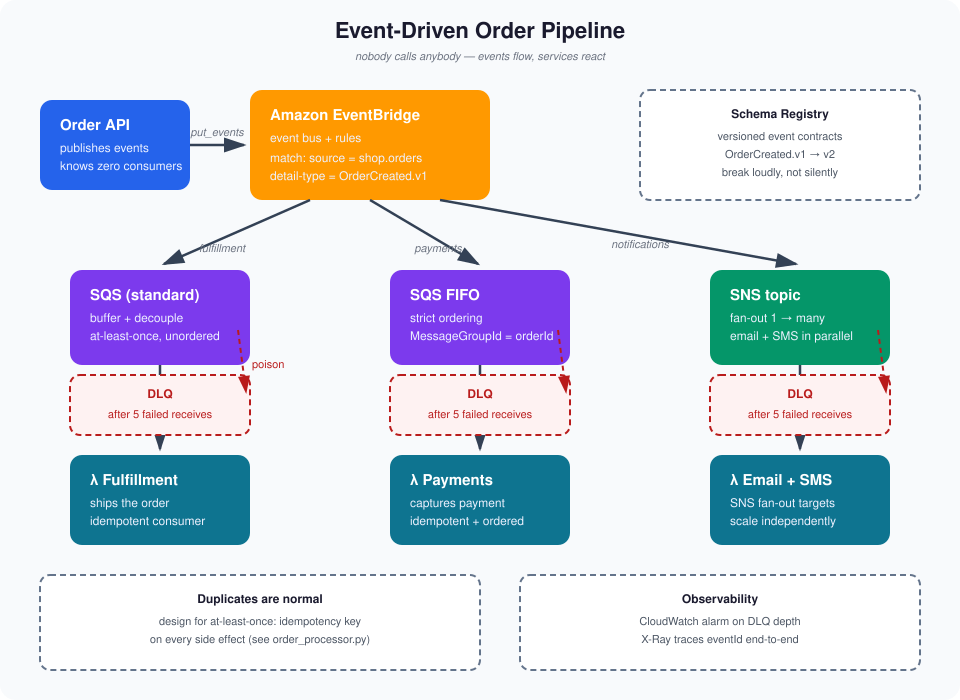

# Event-Driven Architecture Guide

[](https://aws.amazon.com/eventbridge/)
[](order_processor.py)
[](.)
[](quiz.md)

> **TL;DR** — Synchronous calls couple services in time: one slow dependency slows everything down. This guide builds an event-driven order pipeline on AWS — producers emit facts to EventBridge, SQS queues buffer them, Lambda consumers react independently. You get loose coupling, natural buffering under load spikes, and independent scaling, in exchange for eventual consistency and at-least-once delivery you must design for. [`order_processor.py`](order_processor.py) shows the two patterns that make or break EDA in production: **idempotent consumers** and **dead-letter queues**.

---

## Architecture



Events flow left → right, and nothing calls anything directly. The event bus doesn't know the consumers; the consumers don't know the producer. That ignorance is the whole point.

## The 30-second mental model

| Piece | Job | In this guide |
|---|---|---|
| **Producer** | Emits facts about what happened | Order API publishes `OrderCreated` |
| **Event bus** | Routes events to whoever's interested | EventBridge matches rules on the event pattern |
| **Queue** | Buffers and decouples | SQS absorbs traffic spikes between bus and consumer |
| **Consumer** | Reacts, scales independently | Lambda fulfills orders, captures payments |
| **DLQ** | Parks messages that keep failing | SQS dead-letter queue after 5 failed receives |

## Commands vs events — don't mix them up

| | Command | Event |
|---|---|---|
| Intent | "Do this" | "This happened" |
| Naming | Imperative: `ChargeCard` | Past tense: `OrderCreated` |
| Receivers | Exactly one service | Zero to many subscribers |
| Reply | Expected (success / failure) | None — fire and forget |

**Golden rule:** never put a "please" inside an event. If exactly one service must handle it and you need an answer back, that's a command — send it to a queue or call the API directly.

## Choreography vs orchestration

| | Choreography | Orchestration (saga) |
|---|---|---|
| Flow | Services react to events; no central brain | A saga orchestrator (Step Functions) drives each step |
| Coupling | Low — services only know event shapes | Medium — the orchestrator knows every step |
| Best for | Simple flows, many independent reactions | Multi-step transactions needing rollback / compensation |
| Debugging | Harder — trace the event trail (X-Ray helps) | Easier — one execution history |
| Failure mode | A missed event silently stalls downstream | Orchestrator retries or compensates explicitly |

**Rule of thumb:** choreograph the happy path, orchestrate the money path.

## Reliability is designed, not default

SQS standard gives you at-least-once, unordered delivery. Duplicates and out-of-order messages aren't edge cases — they're the contract. Design for them:

| Guarantee | How |
|---|---|
| **Idempotency** | Key every side effect on `eventId`; claim it with a DynamoDB conditional write *before* acting — see [`order_processor.py`](order_processor.py) |
| **Ordering** | SQS FIFO + `MessageGroupId`, only where you truly need it (payments), never by default |
| **Poison messages** | `maxReceiveCount: 5` → DLQ; alarm on DLQ depth; redrive back after the fix |
| **Backpressure** | Batch size + batching window on the Lambda event source; reserved concurrency as a circuit breaker |
| **Schema drift** | EventBridge Schema Registry; version your event types (`OrderCreated.v1`) |

## Quick start

```python
# Producer: emit a fact, don't call a service
publish_order_created(order_id="ord-123", customer_id="cust-42", total_cents=49900)

# Consumer (Lambda, triggered by SQS): idempotent by construction
def lambda_handler(event, context):
    for record in event["Records"]:
        handle_once(extract_detail(record), store)  # DynamoDB conditional write inside
```

Run the local demo — no AWS credentials needed:

```bash
python order_processor.py
```

It replays a duplicate delivery (the second one is skipped), then feeds a poison message through 5 failed attempts until it lands in the DLQ. The full annotated version is in [`order_processor.py`](order_processor.py).

## Common gotchas

1. **"My consumer ran twice and charged the card twice"** → you treated at-least-once like exactly-once. The idempotency key belongs on the side effect, not in a log line.
2. **FIFO everywhere "to be safe"** → FIFO caps throughput per message group and costs more. Use it for payments, not for welcome emails.
3. **No DLQ** → one malformed message retries forever, burning Lambda invocations and paging you at 3 AM. DLQ + a CloudWatch alarm on `ApproximateNumberOfMessagesVisible`.
4. **Events dressed as commands** → `SendWelcomeEmail` with one subscriber that must succeed is a command in an event costume. Point-to-point queue or a direct API call instead.
5. **No schema registry** → six months later nobody remembers which fields `OrderCreated` has. Register the schema, version it, break it loudly.

## Contents

| File | What it is |
|---|---|
| `README.md` | This guide |
| `architecture.svg` | Event flow reference diagram |
| `order_processor.py` | Producer + idempotent Lambda consumer (runnable demo) |
| `quiz.md` | 5-question self-test with answers |

## Quiz teaser

> Your payment consumer receives the same `PaymentCaptured` event twice. The second delivery must be a silent no-op. Where exactly do you put the idempotency check — and which DynamoDB feature makes the check race-safe? 🤔
>
> Answer in [`quiz.md`](quiz.md) — no peeking!

---

Built as part of a daily cloud-engineering series. Star it if it saved you an incident. ⭐
